<a href="https://www.linkedin.com/in/md-abdullah-848267218/"><b>LinkedIn</b></a>&nbsp; · &nbsp;<a href="https://medium.com/@mdabdullah.dev"><b>Writing</b></a>&nbsp; · &nbsp;<a href="mailto:mdabdullah.dev@gmail.com"><b>Email</b></a>

 

## Overview

> Senior Software Engineer turning business requirements into **reliable, scalable digital products** — owning the lifecycle from requirement analysis and architecture through implementation, testing, deployment and iteration.

<table>
<tr>
<td width="33%" valign="top">

**Product Engineering**

Scalable web applications with Next.js, React, Node.js and Laravel — built to ship fast without trading away quality.

</td>
<td width="33%" valign="top">

**Technical Leadership**

Lead developers and cross-functional teams. Own technical decisions, code quality and delivery timelines.

</td>
<td width="34%" valign="top">

**Client Partnership**

Direct client communication, requirement translation and long-term partnerships with agencies and businesses.

</td>
</tr>
</table>

|                 |                                                             |
| :-------------- | :---------------------------------------------------------- |
| **Currently**   | Senior Software Engineer @ **IT Services Bangladesh**       |
| **Core stack**  | Next.js · TypeScript · Node.js · Laravel                    |
| **Specialized** | Telegram Mini Apps · TON Wallet · Shopify · React Native    |
| **Education**   | B.Sc in Computer Science — University of South Asia         |
| **Award**       | Web Development Asset — Skill Competition 2023              |
| **Reach me**    | [mdabdullah.dev@gmail.com](mailto:mdabdullah.dev@gmail.com) |

## Tech Stack

<table>
<tr>
<td width="24%" valign="middle"><b>Languages</b></td>
<td valign="middle"></td>
</tr>
<tr>
<td valign="middle"><b>Frontend</b></td>
<td valign="middle"></td>
</tr>
<tr>
<td valign="middle"><b>Backend</b></td>
<td valign="middle"></td>
</tr>
<tr>
<td valign="middle"><b>Data</b></td>
<td valign="middle"></td>
</tr>
<tr>
<td valign="middle"><b>Tooling</b></td>
<td valign="middle"></td>
</tr>
<tr>
<td valign="middle"><b>Specialized</b></td>
<td valign="middle">

</td>
</tr>
</table>

## Experience

<table>
<tr>
<td width="30%" valign="top">

#### IT Services Bangladesh

`Full-time` `Remote`

Vilniaus, Lithuania · 7 mos

</td>
<td width="70%" valign="top">

**Senior Software Engineer**

Lead end-to-end software development and technical project delivery, working closely with clients and a multidisciplinary team to transform business requirements into reliable, scalable solutions.

- Develop scalable web applications using **React, Next.js, Node.js and Laravel**
- Communicate with clients to translate business ideas into technical solutions
- Lead and coordinate developers and cross-functional team members
- Own project planning, technical decisions, code quality and delivery timelines
- Build long-term partnerships with agencies and businesses

</td>
</tr>
</table>

<table>
<tr>
<td width="30%" valign="top">

#### Most Lab

`Full-time` `Remote`

Dhaka, Bangladesh · 7 mos

</td>
<td width="70%" valign="top">

**Software Engineer**

Full Stack Developer building responsive, user-focused web applications under tight product timelines.

- Rapid product development — high-quality MVPs and full-scale apps from scratch
- Scalable frontend architecture in **Next.js**, backend services in **Node.js**
- Collaborate directly with clients to ship functional features on deadline
- Efficient state management and API integrations for seamless UX

</td>
</tr>
</table>

<table>
<tr>
<td width="30%" valign="top">

#### Banbox.com

`Full-time` `On-site`

Mirpur, Dhaka · 1 mo

</td>
<td width="70%" valign="top">

**Frontend Developer**

Worked on Banbox's eCommerce project, translating Figma designs into responsive, user-friendly interfaces.

- Implement UI components from Figma with pixel-accurate fidelity
- Maintain design consistency across the storefront
- Deliver a smooth user experience across all device sizes

</td>
</tr>
</table>

<table>
<tr>
<td width="30%" valign="top" rowspan="2">

#### iTechHut

`Freelance` `Remote`

Bangladesh · 1 yr 11 mos

 

**Shipped** — VestorNet (Mortgage Network), Bookt (Service Management)

</td>
<td width="70%" valign="top">

**React Native Developer** &nbsp;Jan 2025 — Aug 2025 · 8 mos

Extended existing web products to mobile platforms.

- Built a React Native app mirroring core web features
- Integrated APIs for consistent data flow between web and mobile
- Improved mobile user engagement and app usability
- Partnered with frontend and backend teams to maintain feature parity

</td>
</tr>
<tr>
<td valign="top">

**Frontend Developer** &nbsp;Oct 2023 — Dec 2024 · 1 yr 3 mos

Built responsive, user-focused web applications.

- Developed **5+ production web applications** using React, Vue.js and Laravel
- Implemented reusable UI components and responsive layouts
- Integrated RESTful APIs and authentication systems
- Improved page load speed by **30%** through frontend optimization

</td>
</tr>
</table>

<table>
<tr>
<td width="30%" valign="top">

#### Bit Encrypt IT

`Freelance` `Remote`

Banasree, Dhaka · 7 mos

 

**Shipped** — Ready How (Multi-vendor eCommerce)

</td>
<td width="70%" valign="top">

**Software Developer**

Full-stack work on production-level eCommerce and content platforms.

- Built multi-vendor platforms with **React, Next.js, Node.js and MongoDB**
- Developed reusable frontend components and integrated RESTful APIs
- Optimized performance through lazy loading and query optimization
- Collaborated with designers and stakeholders to deliver features on time

</td>
</tr>
</table>

## Selected Work

<table>
<tr>
<td width="50%" valign="top">

### [TON NFT Commerce](https://github.com/Mdabdullah3/Ton-NFT-E-commerce-Tma-Apps-)

Telegram Mini App for buying NFTs without leaving Telegram, wired to TON Wallet.

`TypeScript` `Telegram` `TON`

</td>
<td width="50%" valign="top">

### VestorNet

Mortgage network platform connecting lenders and brokers to move deals forward.

`React` `Laravel` `REST API`

</td>
</tr>
<tr>
<td valign="top">

### Ready How

Multi-vendor eCommerce platform with vendor dashboards and full order flow.

`Next.js` `Node.js` `MongoDB`

</td>
<td valign="top">

### Bookt

Service management platform for booking, scheduling and provider operations.

`Vue.js` `Laravel` `MySQL`

</td>
</tr>
<tr>
<td valign="top">

### [XandOS Analytics](https://github.com/Mdabdullah3/XandOS-Analytics-Dashboard)

Analytics dashboard with real-time data visualization and reporting.

`TypeScript` `Next.js` `Charts`

</td>
<td valign="top">

### [Babur Hat](https://github.com/Mdabdullah3/Babur-Hat)

Multi-vendor marketplace with complete vendor dashboards and order management.

`JavaScript` `MERN` `MongoDB`

</td>
</tr>
</table>

**More repositories** — <a href="https://github.com/Mdabdullah3/Solana-Blinks">Solana Blinks</a> · <a href="https://github.com/Mdabdullah3/Lazorkit-Sdk">Lazorkit SDK</a> · <a href="https://github.com/Mdabdullah3/shopify-theme">Shopify Theme</a>

## GitHub Analytics

<table>
<tr>
<td width="50%">

</td>
<td width="50%">

</td>
</tr>
</table>

<picture>
  <source media="(prefers-color-scheme: dark)" srcset="https://raw.githubusercontent.com/Mdabdullah3/Mdabdullah3/output/github-contribution-grid-snake-dark.svg" />
  <source media="(prefers-color-scheme: light)" srcset="https://raw.githubusercontent.com/Mdabdullah3/Mdabdullah3/output/github-contribution-grid-snake.svg" />
  
</picture>

## Connect

